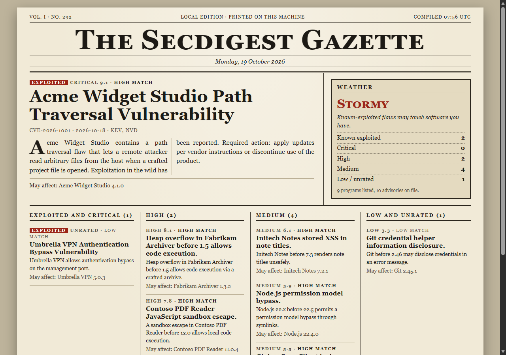

# secdigest

A daily security digest filtered to the software you actually have installed. It keeps a local list of your programs, pulls public advisory feeds only when you ask, and tells you which items *may* affect something you run. It never says you are vulnerable: each match carries a confidence label, the reason it matched, and the version you should check.

(Screenshot uses a made-up inventory and made-up advisories.)

Node 22.5 or newer (developed on 26), no dependencies. Storage is a SQLite file via node:sqlite, by default `%LOCALAPPDATA%\secdigest\secdigest.db` (override with `--db FILE` or `SECDIGEST_DB`).

## Use

    node bin/secdigest.js inventory            # scan, read-only
    node bin/secdigest.js update               # the only command that touches the network
    node bin/secdigest.js digest               # text; also --format md|html, --out FILE
    node bin/secdigest.js ui                   # front page at http://127.0.0.1:8787/

`inventory` reads the three Uninstall registry keys through a read-only PowerShell snippet, adds `winget list` if winget exists (`--no-winget` to skip), and records node, python, java, git and cmake versions it can run. Scanned entries are replaced on each scan; manual ones are kept.

    secdigest inventory add leftpadder 1.0.0 --ecosystem npm
    secdigest inventory ignore "Microsoft Visual C++*"
    secdigest inventory allow Acme       # once any allow rule exists, only matching programs are used
    secdigest feeds add https://vendor.example/security.xml --vendor Vendor
    secdigest update --dry-run           # prints what it would fetch
    secdigest update --only kev,nvd --days 3
    secdigest digest --days 7 --min medium

Feeds: CISA KEV (ETag/If-Modified-Since cached), NVD CVE 2.0 by last-modified window (6.5 s between requests, 0.7 s if `NVD_API_KEY` is set), OSV for inventory entries you gave an `--ecosystem`, and any RSS/Atom feeds you add. A failing or malformed feed is reported and skipped; the others still run.

Matching compares CPE vendor/product (with version ranges), KEV vendor/product, OSV package and version, and feed text against program names and publishers. Known-exploited items sort first, then confidence, severity and CVSS. In the UI the lead story is the top item, columns are by severity, and clicking an item shows the software it matched and why. The UI binds 127.0.0.1, rejects other Host headers, requires Origin and a per-run token for its one write action (adding an ignore rule), loads no external resources, and takes `--no-open`, `--browser EXE` or the `BROWSER` variable.

## Tests

    node --test

Tests run against fixture feeds in `test/fixtures` and a local fake HTTP server, including truncated JSON, HTML in place of a feed, 503s and a dead port.

## A real run

On the author's machine a first `inventory` found 143 entries (91 registry, 49 winget, 3 toolchain; python and java were not found). `update` fetched 1748 KEV entries and 606 NVD CVEs modified in two days. The NVD request timed out at the original 30 s on the first try, so the timeout is now 120 s with 500 results per page. The 30 day digest at medium confidence or better was empty; at low confidence it held one KEV item, a generic Windows entry that matched "Windows SDK AddOn" by name only.

## Known gaps

- Matching is by name, so it misses programs whose display name differs from the CPE product, and it will still produce false positives. Platform words like "Windows" or "Office" are capped at low confidence, which also means real OS-level KEV entries show up as low.
- KEV has no version ranges; those matches only say to check your version. NVD entries without CPE configurations (new or unanalyzed CVEs) can only be matched if KEV also lists them.
- OSV only runs for entries with an ecosystem you set by hand. Installed programs are not mapped to ecosystems.
- The winget parser relies on column positions, so wide characters in names can shift a column. Winget entries carry no publisher.
- Version comparison is numeric segments only; pre-release tags are ignored.
- Digest windows use the advisory's published date (KEV: date added), not the date you first fetched it.
- No scheduler. Run `update` yourself or from Task Scheduler.
- The UI was only screenshotted in headless Edge; Firefox/LibreWolf was not driven.
